  

  
  
  
  

---

## 🚪 About

I'm a **Cloud DevOps Engineer and Full-Stack Developer** who builds the infrastructure *and* the product on top of it.

- ☁️ Provision AWS end to end with **Terraform**: VPCs, 3-tier architectures, EKS, ECS Fargate, Lambda and API Gateway
- 🔁 Build **CI/CD pipelines** with Jenkins, Docker, Packer AMIs and Helm, deploying to Kubernetes
- 📈 Set up **monitoring and observability** with CloudWatch, Lambda collectors and S3 log pipelines
- 🤖 Exploring **MLOps** and **Forward Deployed Engineering**: taking models and tools into real client workflows
- 💻 Ship **React + TypeScript + Firebase** SaaS apps: CRMs, admin dashboards and finance and real-estate websites
- 🌱 Currently learning: _Gen AI / Agentic AI on AWS_

---

## 🛠️ Tech Stack

  
   
  

| Area | Tools |
|---|---|
| **Cloud** | AWS (EC2, VPC, EKS, ECS Fargate, Lambda, API Gateway, S3, CloudWatch, IAM / SSO) |
| **IaC** | Terraform, Packer, Helm |
| **CI/CD** | Jenkins, GitHub Actions, Maven, Docker |
| **Containers** | Kubernetes, EKS, microservices |
| **Frontend** | React, TypeScript, Vite, Tailwind, shadcn/ui |
| **Backend** | Firebase, Spring Boot, Python, PHP |

---

## 🚀 Featured Projects

| Project | What it does | Stack |
|---|---|---|
| [eks-3-tier-project](https://github.com/soundaryacs/eks-3-tier-project) | 3-tier app on Amazon EKS, provisioned with Terraform | Terraform · EKS · K8s |
| [EKS-Cluster-CI-CD](https://github.com/soundaryacs/EKS-Cluster-CI-CD) | End-to-end CI/CD into an EKS cluster | Jenkins · Docker · EKS |
| [ECS-Fargate-Implimentation-using-IaC](https://github.com/soundaryacs/ECS-Fargate-Implimentation-using-IaC) | Serverless containers on ECS Fargate | Terraform · ECS |
| [Lambda-CICD-SSO-IaC-Project](https://github.com/soundaryacs/Lambda-CICD-SSO-IaC-Project) | Lambda delivery pipeline with SSO, all in IaC | Terraform · Lambda · SSO |
| [Serverless-EC2-Scheduler](https://github.com/soundaryacs/Serverless-EC2-Scheduler) | Cost saving: starts and stops EC2 on a schedule | Lambda · EventBridge |
| [microservices-ecommerce-k8s](https://github.com/soundaryacs/microservices-ecommerce-k8s) | Microservices e-commerce on Kubernetes | Python · K8s |
| [MLOPS](https://github.com/soundaryacs/MLOPS) | ML model training and deployment pipeline | Python · MLOps |
| [lifevault-infra-terraform](https://github.com/soundaryacs/lifevault-infra-terraform) | Production infra + Helm charts for the LifeVault platform | Terraform · Helm |
| [euphoria-capital-web](https://github.com/soundaryacs/euphoria-capital-web) | Investment firm website with admin dashboard | React · TS · Firebase |
| [glozia-crm](https://github.com/soundaryacs/glozia-crm) | Sales CRM for a business client | React · TS |

---

## 📊 GitHub Stats

  
  

  

---

## 🤝 Let's Connect

Always happy to talk **Cloud, DevOps and Platform Engineering**, or a web project you have in mind.
Reach me on [LinkedIn](https://www.linkedin.com/in/soundaryacs92/).

<i>“Automate the boring, ship the important.”</i>

