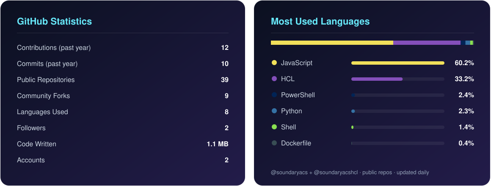

  

  
  
  
  
  

---

## 🚪 About

I'm a **Cloud DevOps Engineer and Full-Stack Developer** who builds the infrastructure *and* the product on top of it.

- ☁️ Provision AWS end to end with **Terraform**: VPCs, 3-tier architectures, EKS, ECS Fargate, Lambda and API Gateway
- 🔁 Build **CI/CD pipelines** with Jenkins, Docker, Packer AMIs and Helm, deploying to Kubernetes
- 📈 Set up **monitoring and observability** with CloudWatch, Lambda collectors and S3 log pipelines
- 🤖 Exploring **MLOps** and **Forward Deployed Engineering**: taking models and tools into real client workflows
- 💻 Ship **React + TypeScript + Firebase** SaaS apps: CRMs, admin dashboards and finance and real-estate websites
- 🌱 Currently building: _Gen AI and agentic workflows on AWS_

---

## 📊 By the Numbers

---

## 🤖 Generative AI

<b>What I build</b>

 

- **RAG on AWS:** S3 document ingest, chunking in Lambda, Bedrock embeddings, OpenSearch / pgvector retrieval
- **Serverless delivery:** API Gateway + Lambda front door, all provisioned with Terraform
- **Guardrails:** PII filtering and grounding checks before an answer goes back to the user
- **Ops built in:** CloudWatch logs, latency and token-cost dashboards from day one
- **MLOps foundations:** model training and deployment pipelines ([MLOPS](https://github.com/soundaryacs/MLOPS))

---

## 🧠 Agentic AI

<b>What I build</b>

 

- **Ops agents** that triage CloudWatch alerts and propose a fix
- **Scoped tool access** through MCP servers: AWS APIs, kubectl / Helm, Terraform plan
- **Human-in-the-loop:** nothing is applied until someone reviews the diff and risk
- **Runbook RAG** so agents answer from the team's own docs, not guesses
- **Audit trail:** every step traced and logged to S3

---

## 🛰️ Forward Deployed Engineering

<b>How an engagement runs</b>

 

1. **Discover:** sit with the team, map the workflow and agree what success looks like
2. **Prototype:** a working demo on their real data, fast
3. **Productionise:** Terraform, CI/CD pipelines and a security review
4. **Deploy & Operate:** in their own AWS account, with monitoring and cost tracking
5. **Hand Over:** runbooks and docs so their team owns it

Practice and write-ups: [FDE-Python-Practice](https://github.com/soundaryacs/FDE-Python-Practice)

---

## 🎯 Current Focus

- 🤖 **Building** Gen AI apps on AWS: RAG with Bedrock and OpenSearch, deployed with Terraform
- 🧠 **Learning** agentic workflows for DevOps: alert triage, remediation agents and runbook assistants
- 🔌 **Exploring** the Model Context Protocol (MCP) for safe, scoped access to AWS, Kubernetes and CI/CD
- 🛰️ **Practising** Forward Deployed Engineering: client discovery through to production rollout
- 💻 **Shipping** React + TypeScript + Firebase apps for clients: CRMs, dashboards and websites

<b>🤝 What I'm useful for</b>

 

- Taking an AWS workload from console clicks to **Terraform + CI/CD**
- Standing up **EKS / ECS** with pipelines, monitoring and cost controls
- Building a **full-stack web app** and the cloud it runs on
- Turning a Gen AI idea into a **working prototype on AWS**

<b>🧭 How I work</b>

 

- Infrastructure as code first, no hand-built resources
- Small, reviewable changes and automated pipelines
- Monitoring and cost visibility from day one
- Document as I go, so the next person can own it

---

## 🛠️ Technology Stack

<table width="100%">
<tr>
<td width="50%" valign="top">

<b>☁️ Cloud & Serverless</b>  

<b>⚙️ DevOps & IaC</b>  

<b>📈 Monitoring</b>  

</td>
<td width="50%" valign="top">

<b>💻 Languages & Frameworks</b>  

<b>🗄️ Data & Backend</b>  

<b>🤖 Gen AI & Agentic AI</b>  

</td>
</tr>
</table>

---

## 🚀 Featured Projects

| Project | What it does | Stack |
|---|---|---|
| [UC-09-EKS-Cluster](https://github.com/soundaryacshcl/UC-09-EKS-Cluster) | Amazon EKS cluster provisioned with Terraform | Terraform · EKS · K8s |
| [EKS-Cluster-CI-CD](https://github.com/soundaryacs/EKS-Cluster-CI-CD) | End-to-end CI/CD into an EKS cluster | Jenkins · Docker · EKS |
| [ECS-Fargate-Implimentation-using-IaC](https://github.com/soundaryacs/ECS-Fargate-Implimentation-using-IaC) | Serverless containers on ECS Fargate | Terraform · ECS |
| [Lambda-CICD-SSO-IaC-Project](https://github.com/soundaryacs/Lambda-CICD-SSO-IaC-Project) | Lambda delivery pipeline with SSO, all in IaC | Terraform · Lambda · SSO |
| [Serverless-EC2-Scheduler](https://github.com/soundaryacs/Serverless-EC2-Scheduler) | Cost saving: starts and stops EC2 on a schedule | Lambda · EventBridge |
| [Packer-AMI-LT-Jenkins](https://github.com/soundaryacs/Packer-AMI-LT-Jenkins) | Golden AMIs with Packer, rolled out via launch templates | Packer · Jenkins · EC2 |
| [AWS-Monitoring](https://github.com/soundaryacs/AWS-Monitoring) | Monitoring and alerting for AWS workloads | CloudWatch · Terraform |
| [microservices-ecommerce-k8s](https://github.com/soundaryacshcl/microservices-ecommerce-k8s) | Microservices e-commerce on Kubernetes | Python · K8s |
| [MLOPS](https://github.com/soundaryacs/MLOPS) | ML model training and deployment pipeline | Python · MLOps |
| [LifeVault_UserDashboard](https://github.com/soundaryacs/LifeVault_UserDashboard) | User dashboard for the LifeVault platform | React · TypeScript |

> 🗂️ More cloud use cases (UC-03 to UC-12), Terraform best practices and CI/CD labs are on my second account: **[@soundaryacshcl](https://github.com/soundaryacshcl)**

---

## 📈 GitHub Analytics

  

---

## 🤝 Let's Connect

Always happy to talk **Cloud, DevOps and Platform Engineering**, or a web project you have in mind.
Reach me on [LinkedIn](https://www.linkedin.com/in/soundaryacs92/), or see more of my work at [github.com/soundaryacshcl](https://github.com/soundaryacshcl).

<i>“Automate the boring, ship the important.”</i>

